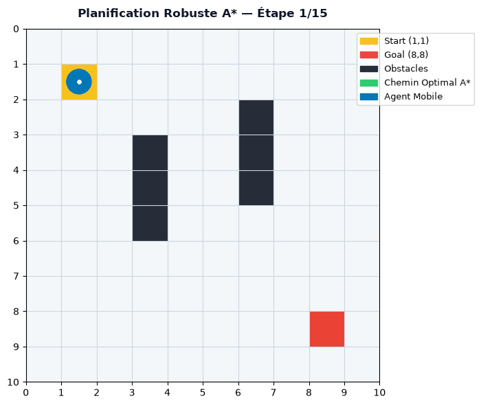
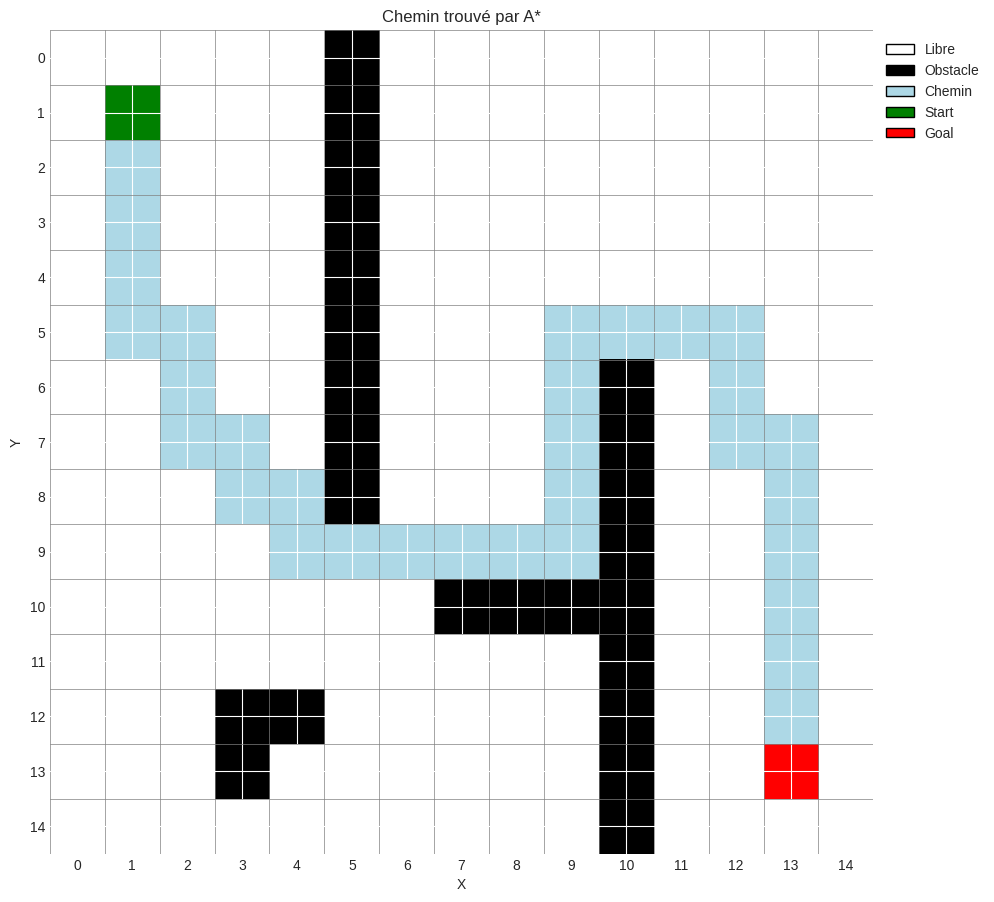
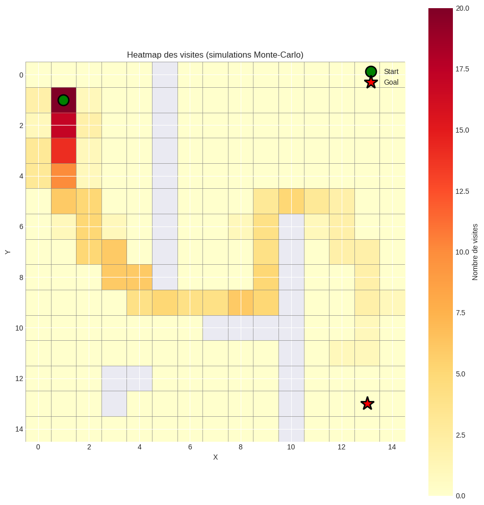
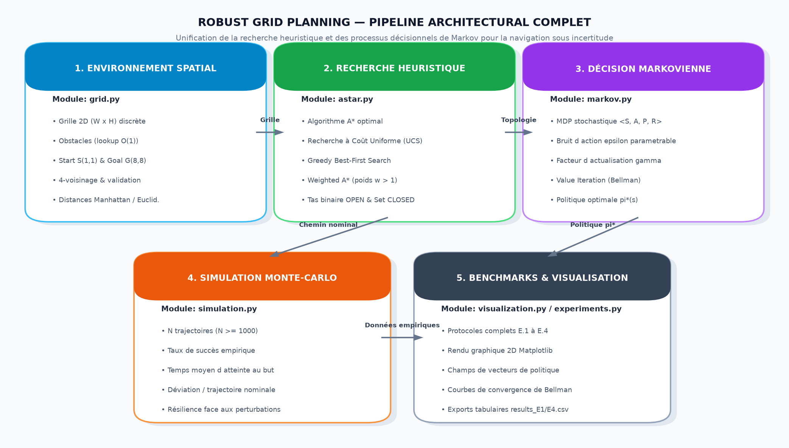

<div align="center">
  <!-- En-tête créatif -->
  

  <!-- Animation texte ciblant "Ce que fait le projet" et "Pourquoi c'est utile" -->
  

  <br/>

  <!-- Badges recommandés par GitHub -->
  <p>
    
    
    
  </p>
</div>

---

<!-- 1. CE QUE FAIT LE PROJET -->
## À propos du projet

**Robust Grid Planning** est une suite algorithmique d'intelligence artificielle et de planification robuste sous incertitude conçue pour modéliser, planifier et évaluer des trajectoires optimales sur grille 2D face à des perturbations stochastiques (glissements, déviations de cap et bruits d'action). Elle permet aux chercheurs, ingénieurs et étudiants en IA d'unifier la recherche heuristique déterministe (A*, UCS, Greedy, Weighted A*) et les Processus Décisionnels de Markov (MDP via Value Iteration et Policy Iteration), tout en validant empiriquement la résilience des politiques calculées par des simulations Monte-Carlo vectorisées, sans avoir à subir les échecs de trajectoires nominales causés par la perte d'adhérence ou les aléas de terrain.

> [!NOTE]
> Pour une vue détaillée des choix de conception et des schémas système, consultez la [documentation d'architecture](docs/ARCHITECTURE.md).

<!-- APERÇU VISUEL (GIF + CAPTURES D'ÉCRAN) -->
### Aperçu en action

<div align="center">
  <!-- GIF principal ou image de couverture (utiliser un chemin relatif) -->
  
  <p><em>Démonstration rapide : Exécution de la planification de trajectoire et convergence stochastique vers le but</em></p>
</div>

<details open>
  <summary><b>Voir plus de captures d'écran (Interface & Architecture)</b></summary>
  <br/>

| Navigation sur Grille & Chemin Optimal A* | Convergence & Heatmap Monte-Carlo |
| :---: | :---: |
|  |  |

<div align="center">

**Pipeline de Planification Hybride**<br/><br/>


</div>
</details>

<!-- 2. POURQUOI LE PROJET EST UTILE -->
## Pourquoi utiliser ce projet ?

Ce projet répond à la problématique de la fragilité des trajectoires déterministes classiques (A* pur) lorsqu'un agent mobile évolue dans un milieu soumis aux incertitudes physiques (glissement du robot, action non déterministe, transitions probabilistes), en apportant des avantages concrets :

- **Planification Heuristique Haute Performance :** Implémentation complète et optimisée d'A*, UCS, Greedy Best-First Search et Weighted A* avec heuristiques admissibles et cohérentes (Manhattan, Euclidienne).
- **Contrôle Robuste par Processus Décisionnels de Markov (MDP) :** Modélisation mathématique rigoureuse des transitions stochastiques avec résolution exacte par programmation dynamique (Value Iteration avec seuil $\theta$ et Policy Iteration).
- **Validation Empirique par Simulations Monte-Carlo :** Moteur stochastique exécutant des milliers d'épisodes pour quantifier le taux de succès, le temps moyen d'absorption et la déviation par rapport à la trajectoire nominale.
- **Suite Expérimentale Reproductible & Rendu Graphique :** Quatre bancs d'essais complets (E.1 à E.4), export de données tabulaires CSV (`results_E1.csv`, `results_E4.csv`) et visualisations Matplotlib 2D (champs de vecteurs de politiques, cartes d'obstacles, faisceaux de trajectoires).

### Stack Technique

| Couche | Technologies |
| :--- | :--- |
| **Langage & Calcul Numérique** | `Python 3.8+`, `NumPy` (matrices de transition & calcul matriciel) |
| **Algorithmes & IA** | `A* Search`, `UCS`, `Greedy Search`, `Weighted A*`, `MDP (Bellman, Value & Policy Iteration)` |
| **Simulation & Données** | `Monte Carlo Simulator Engine`, `Pandas` (statistiques & export CSV) |
| **Visualisation & Interfaces** | `Matplotlib` (rendu 2D & graphiques), `Jupyter Notebook`, `CLI interactif` |

<!-- 3. COMMENT DÉMARRER -->
## Pour commencer

Suivez ces instructions pour déployer et exécuter une instance locale du projet pour le développement et les tests.

### Prérequis

Assurez-vous d'avoir installé les outils suivants sur votre environnement :

- `Python` (v3.8 ou supérieur)
- `pip` (gestionnaire de paquets officiel de Python)
- `Git` (système de contrôle de version)

### Installation

1. **Cloner le dépôt**
   ```bash
   git clone https://github.com/essoktani-yazid/robust-grid-planning.git
   cd robust-grid-planning
   ```

2. **Créer et activer un environnement virtuel (recommandé)**
   ```bash
   python3 -m venv venv
   source venv/bin/activate  # Sur Linux / macOS
   # venv\Scripts\activate   # Sur Windows
   ```

3. **Installer les dépendances**
   ```bash
   pip install -r requirements.txt
   ```

### Exemple d'utilisation

Une fois les dépendances installées, vous pouvez lancer le menu interactif en ligne de commande :

```bash
python3 main.py
```

Vous pouvez également intégrer directement les modules Python dans votre propre code :

```python
from grid import create_simple_grid
from astar import PathFinder
from markov import MarkovChain
from simulation import MonteCarloSimulator

# 1. Instancier l'environnement de navigation
grid = create_simple_grid()

# 2. Résolution heuristique déterministe avec A*
finder = PathFinder(grid)
stats = finder.astar()
print(f"Chemin A* trouvé : {len(stats.path)} étapes | Coût : {stats.cost:.2f}")

# 3. Modélisation stochastique MDP avec bruit (bruit = 15%)
mdp = MarkovChain(grid, gamma=0.9, noise=0.15)
vi_result = mdp.value_iteration(theta=0.01)
print(f"Value Iteration convergée en {vi_result['iterations']} itérations")

# 4. Évaluation empirique de la robustesse via Monte-Carlo
simulator = MonteCarloSimulator(grid, mdp)
results = simulator.run_simulations(start=grid.start, n_episodes=1000, verbose=False)
print(f"Taux de succès sous incertitude : {results['success_rate']:.2f}%")
```

*Pour découvrir l'ensemble des modules, fonctions et interfaces disponibles, consultez la [Référence API complète](docs/API.md).*

### Structure du projet

```text
.
├── docs/
│   ├── assets/              # Captures d'écran, GIFs et visualisations graphiques
│   ├── API.md               # Documentation complète de l'API et des modules
│   └── ARCHITECTURE.md      # Conception technique et schémas du pipeline IA
├── astar.py                 # Implémentations d'A*, UCS, Greedy et Weighted A*
├── grid.py                  # Modélisation spatiale de la grille 2D et obstacles
├── markov.py                # Processus Décisionnels de Markov (Value & Policy Iteration)
├── simulation.py            # Simulateur Monte-Carlo et métriques de robustesse
├── visualization.py         # Moteur de rendu graphique 2D avec Matplotlib
├── experiments.py           # Protocoles expérimentaux automatisés (E.1 à E.4)
├── main.py                  # CLI interactive et point d'entrée rapide
├── notebook.ipynb           # Notebook Jupyter d'expérimentation interactive
├── requirements.txt         # Dépendances Python requises
├── LICENCE                  # Licence MIT du projet
└── README.md                # Documentation principale du projet
```

<!-- 4. AIDE & SUPPORT -->
## Aide et Support

Vous avez une question sur l'architecture ou l'implémentation du projet ?
- **Documentation :** Consultez les fichiers techniques présents dans le dossier [`docs/`](docs/).
- **Contact direct :** N'hésitez pas à me contacter directement via LinkedIn ou mon portfolio.

<!-- 5. CONTRIBUTION & AUTEUR -->
## Contribuer

Les contributions et propositions d'améliorations sont les bienvenues !
1. **Forkez** le projet
2. Créez votre branche de fonctionnalité (`git checkout -b feature/NouvelleFonctionnalite`)
3. Commitez vos changements (`git commit -m 'feat: Ajout de NouvelleFonctionnalite'`)
4. Pushez vers la branche (`git push origin feature/NouvelleFonctionnalite`)
5. Ouvrez une **Pull Request**

## Auteur

<div align="center">

**Yazid ESSOKTANI**  
*Full-Stack Web & AI Developer*

[](https://www.essoktani.tech/)
[](https://www.linkedin.com/in/yazid-essoktani-337549251)
[](https://github.com/essoktani-yazid)

</div>

---

## Licence

Distribué sous la licence **MIT**. Consultez le fichier [`LICENCE`](LICENCE) pour plus d'informations.
