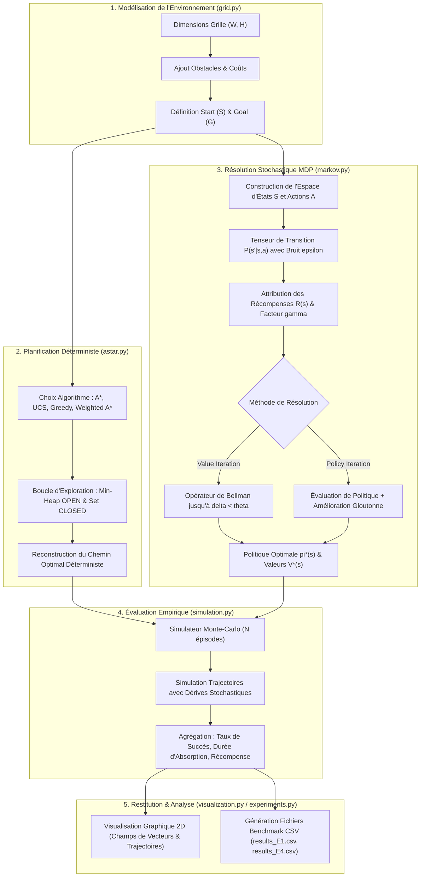

# Architecture du Système — Robust Grid Planning

> Ce document décrit l'architecture technique, les choix de conception et les flux de données de **Robust Grid Planning**.

---

## 1. Vue d'ensemble (High-Level Design)

L'application repose sur une **architecture modulaire en pipeline algorithmique et scientifique**, conçue pour garantir la séparation stricte des responsabilités, la reproductibilité expérimentale et la performance d'exécution.

Le système orchestre l'environnement spatial, la recherche heuristique déterministe ($A^*$, UCS, Greedy, Weighted $A^*$), la modélisation probabiliste par Processus Décisionnels de Markov (MDP), l'évaluation stochastique par simulations Monte-Carlo et le rendu visuel multi-couches.

  
  
<em>Figure 1 : Architecture globale du pipeline de planification et d'évaluation</em>

---

## 2. Composants Principaux

| Composant | Fichier source & Technologie | Rôle & Responsabilités |
| :--- | :--- | :--- |
| **Environnement Spatial** | [`grid.py`](../grid.py) (`NumPy`) | Définition de la grille 2D ($W \times H$), gestion des cellules franchissables et des obstacles (`Set[Tuple[int, int]]`), calcul des distances de Manhattan et Euclidienne, et validation du 4-voisinage. |
| **Moteur Heuristique Déterministe** | [`astar.py`](../astar.py) (`heapq`, `dataclasses`) | Implémentation des algorithmes de recherche sur graphe ($A^*$, UCS, Greedy, Weighted $A^*$). Gestion optimisée de la file de priorité `OPEN` (tas binaire) et de l'ensemble d'états explorés `CLOSED`. |
| **Moteur Décisionnel Stochastique** | [`markov.py`](../markov.py) (`NumPy`) | Modélisation du MDP $\langle \mathcal{S}, \mathcal{A}, \mathcal{P}, \mathcal{R}, \gamma \rangle$ avec bruit de dérive stochastique $\varepsilon$. Calcul de la fonction de valeur optimale $V^*(s)$ et de la politique $\pi^*(s)$ via **Value Iteration** et **Policy Iteration**. |
| **Moteur de Simulation Monte-Carlo** | [`simulation.py`](../simulation.py) (`NumPy`, `Random`) | Génération d'épisodes stochastiques sous politique active pour évaluer empiriquement la robustesse (taux de succès vers le but, temps moyen d'absorption, écart-type et déviation de trajectoire). |
| **Visualisation & Benchmarking** | [`visualization.py`](../visualization.py) / [`experiments.py`](../experiments.py) (`Matplotlib`, `Pandas`) | Rendu graphique 2D (grilles, trajectoires, cartes d'obstacles, champs vectoriels de politiques, courbes de Bellman) et automatisation des bancs d'essais (E.1 à E.4) avec export tabulaire CSV (`results_E1.csv`, `results_E4.csv`). |
| **Interface Utilisateur & CLI** | [`main.py`](../main.py) / [`notebook.ipynb`](../notebook.ipynb) | Point d'entrée interactif pour les utilisateurs et cahier de laboratoire Jupyter pour l'analyse fine et le prototypage rapide. |

---

## 3. Flux de données (Data Workflow)

Le diagramme ci-dessous illustre le pipeline complet de traitement des données, de la configuration initiale de l'environnement à l'analyse comparative des performances :

---

## 4. Modèle de données & Stockage

### Modèle spatial et topologie en mémoire
- **Espace d'états discret $\mathcal{S}$ :** Matrice cartésienne indexée par des coordonnées 2D entières $(x, y) \in [0, W-1] \times [0, H-1]$.
- **Ensemble d'obstacles $\mathcal{O}$ :** Structure `Set[Tuple[int, int]]` garantissant des vérifications d'appartenance et de franchissabilité en complexité temporelle $O(1)$.
- **Carte des coûts variables :** Dictionnaire `cost_map: Dict[Tuple[Tuple[int, int], Tuple[int, int]], float]` supportant des matrices de coût non-uniformes (coût par défaut égal à 1.0).

### Structures de recherche algorithmique
- **Nœud d'arbre (`Node`) :** Dataclass optimisée encapsulant la coordonnée spatiale, le coût exact depuis le départ $g(n)$, la valeur heuristique $h(n)$ (distance de Manhattan ou Euclidienne), le score global $f(n) = g(n) + w \cdot h(n)$ et le pointeur `parent`.
- **Ensembles `OPEN` et `CLOSED` :** 
  - `OPEN` : Min-heap binaire (`heapq`) pour une extraction efficace du nœud minimal en $O(\log N)$.
  - `CLOSED` : Table de hachage `Set[Tuple[int, int]]` interdisant la ré-exploration redondante des états déjà clos.
- **Statistiques de recherche (`SearchStats`) :** Conteneur de métriques capturant le coût final, le nombre de nœuds développés, la taille maximale du tas ouvert, le temps d'exécution en secondes et l'indicateur booléen de succès.

### Modèle décisionnel markovien (MDP)
- **Probabilités de transition $P(s' \mid s, a)$ :** Distribution discrète où l'action voulue $a$ aboutit avec une probabilité $1 - \varepsilon$, tandis que des déviations orthogonales imprévues surviennent avec une probabilité $\varepsilon / 2$.
- **Fonction de valeur $V(s)$ et Politique $\pi(s)$ :** Dictionnaires de lookup mappant chaque position libre vers sa valeur attendue $V^*(s) \in \mathbb{R}$ et vers son action suivante optimale $\pi^*(s) \in \mathcal{S}$.

### Persistance et restitution
- **Fichiers tabulaires CSV :** Persistance sur disque des benchmarks via Pandas (`results_E1.csv`, `results_E4.csv`) récapitulant les performances comparatives (coûts, temps CPU en millisecondes, taux de complétion, variances).
- **Tracés graphiques :** Fichiers images haute résolution générés dans [`docs/assets/`](assets/) pour l'illustration des trajectoires et des politiques.

---

## 5. Sécurité, Robustesse & Déploiement

- **Déterminisme & Reproductibilité :** L'algorithme $A^*$ est strictement déterministe. Les simulations stochastiques Monte-Carlo et l'injection de bruit reposent sur les générateurs pseudo-aléatoires de NumPy, configurables par graines (`seed`) pour une reproductibilité scientifique totale.
- **Gestion des cas limites :** Validation systématique des limites géométriques de la grille (`is_valid`), détection des configurations sans issue (chemins impossibles retournant `SearchStats(success=False)` sans planter le runtime), et gestion des boucles d'absorption.
- **Modularité & Zéro Dépendance Lourde :** Conception sans dépendance externe propriétaire ; fonctionne sous tout interpréteur standard Python 3.8+ avec `NumPy`, `Matplotlib` et `Pandas`.
- **Intégration & Tests :** Chaque module implémente une suite de tests unitaires et d'assertions exécutable directement via `python3 <nom_du_module>.py` pour valider l'intégrité de la chaîne avant exécution des benchmarks globaux.

---
[⬅ Retour au README principal](../README.md)
